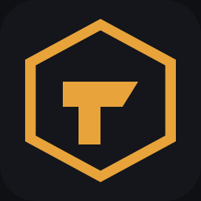
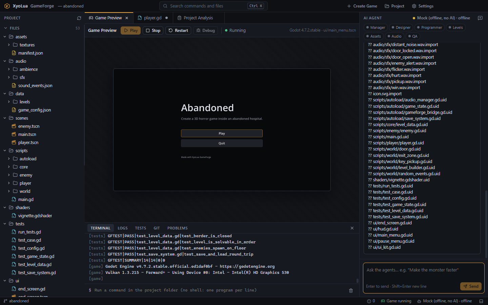
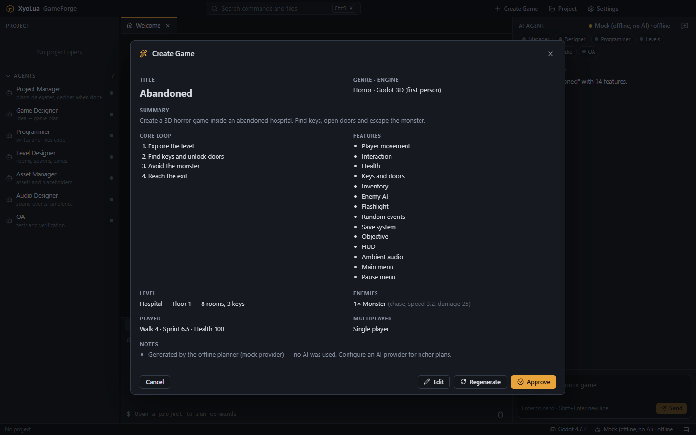
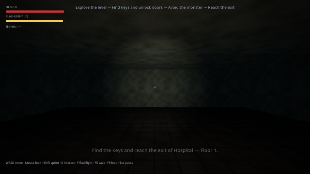
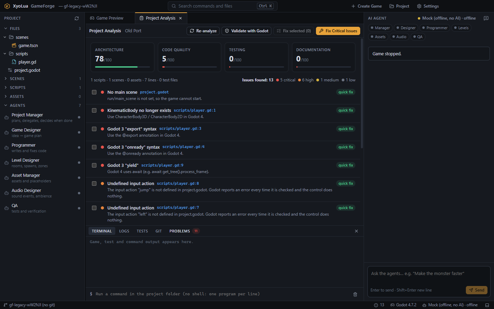
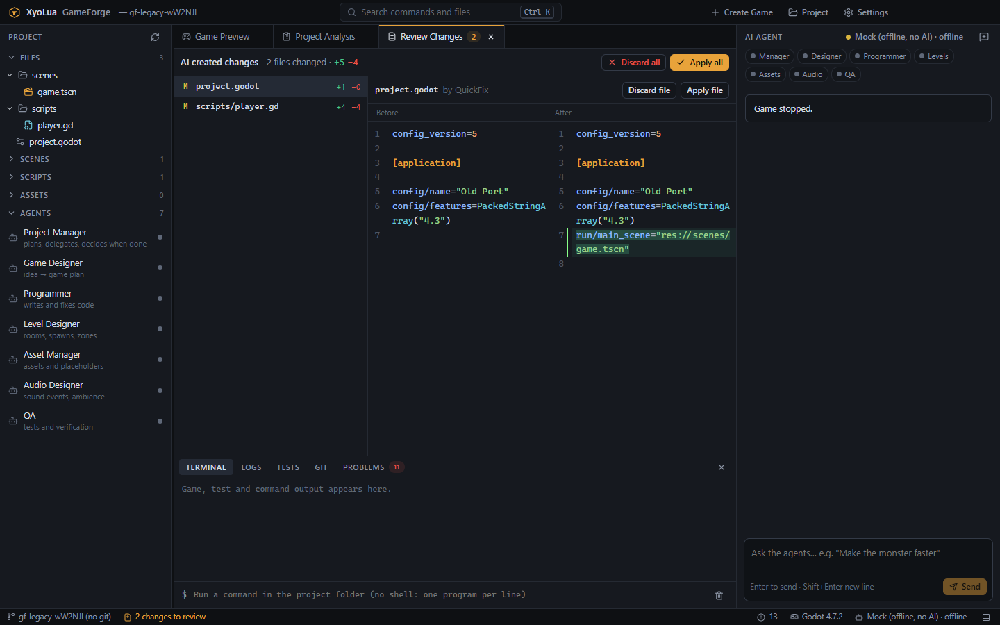

<div align="center">



# XyoLua GameForge

**An open-source, local-first AI game development environment.**
Describe a game, review the plan, get a playable Godot project — built, tested and fixed by a team of AI agents on your machine.

[Getting started](docs/getting-started.md) · [Architecture](docs/architecture.md) · [CLI](docs/cli.md) · [Security](docs/security.md) · [Contributing](CONTRIBUTING.md)

  

</div>



## What it is

GameForge is not a chat window. It is a desktop IDE (plus a CLI and an optional MCP server) where specialized agents — Project Manager, Game Designer, Programmer, Level Designer, Asset Manager, Audio Designer and QA — plan, generate, test and fix real game projects through sandboxed tools.

```
"Create a 3D horror game inside an abandoned hospital.
 The player finds keys, opens doors and is hunted by a monster."
        ↓
GAME PLAN  →  you approve / edit / regenerate
        ↓
Godot 4 project: scenes, scripts, level, placeholder art & audio, tests
        ↓
validated in Godot · tests run · ▶ Play
```

<table>
<tr>
<td></td>
<td></td>
</tr>
<tr>
<td align="center"><sub>Review the plan before anything is generated</sub></td>
<td align="center"><sub>The generated game: flashlight, fog, keys, doors, a monster</sub></td>
</tr>
<tr>
<td></td>
<td></td>
</tr>
<tr>
<td align="center"><sub>Fix my game: analysis with scores and prioritized issues</sub></td>
<td align="center"><sub>Every AI change is a reviewable diff before it touches disk</sub></td>
</tr>
</table>

## Features

- **Create Game** — description → Game Designer plan → **Approve / Edit / Regenerate / Cancel** → complete Godot 4 project (3D first-person or 2D top-down) with player, enemy AI with path-finding, keys & doors, inventory, flashlight, health, save/load, random events, menus, HUD, placeholder textures and synthesized sound effects. Every level is verified to be solvable.
- **Fix My Game** — open any Godot 4 project: static analysis with architecture / code quality / testing / documentation scores, prioritized issues (Godot 3 leftovers, missing references, undefined input actions, broken node paths, unconnected signals, unused assets …), a fix plan with deterministic quick fixes and AI fixes, staged diff review, apply, automatic tests.
- **Multi-agent system** — a Project Manager delegates to specialists; every agent has its own tool set. The agent log shows each tool call live.
- **Real engine integration** — headless validation (import, load every script and scene, smoke-run the game scene), a test runner with machine-readable results, ▶ Play / ⏹ Stop / ↻ Restart / 🐛 Debug with stdout/stderr in the terminal and a **live preview** of the running game.
- **Developer tool, not a chat site** — project explorer, CodeMirror editor (GDScript highlighting, search & replace, diagnostics, **AI edit** with Ctrl+I), diff viewer, terminal, logs, tests, git panel, command palette (**Ctrl+K**), keyboard shortcuts.
- **Bring your own AI** — Anthropic, any OpenAI-compatible API (OpenAI, OpenRouter, Groq, LM Studio, vLLM …) or local models via Ollama. An offline mock provider lets you try and develop GameForge without a key.
- **Safe by design** — workspace sandbox, protected secrets, command allowlist without a shell, confirmations for risky actions, secret redaction, timeouts and output limits. AI-generated code is treated as untrusted.
- **Git built in** — status, diffs, commits, branches, history. GameForge never pushes on its own.
- **CLI** — `gameforge create | analyze | fix | chat | test | run | doctor | config | mcp`.
- **Extensible** — a public plugin API for engines, tools, AI providers and agents; an optional MCP server for Claude Desktop, Claude Code and other MCP clients.
- **Private** — no account, no analytics, no telemetry. Nothing is sent to XyoLua.

## Installation

### Desktop app

Installers for Windows (`.exe`), macOS (`.dmg`) and Linux (`.AppImage`, `.deb`) are built by the [release workflow](.github/workflows/release.yml) and attached to [GitHub Releases](https://github.com/xyoluastudios/xyolua-gameforge/releases). The builds are not code-signed yet, so Windows SmartScreen and macOS Gatekeeper will warn on first launch.

### From source

Requirements: **Node.js 22.12+**, **pnpm 10** (`corepack enable`), **Git**, and **[Godot 4.3+](https://godotengine.org/download)** to run games.

```bash
git clone https://github.com/xyoluastudios/xyolua-gameforge.git
cd xyolua-gameforge
pnpm install
pnpm build
pnpm --filter @gameforge/desktop start    # launch the desktop app
```

## Quick start

1. Start GameForge and open **Settings → AI Provider** (or create a `.env` from [.env.example](.env.example)).
2. **Settings → Godot**: GameForge detects Godot on your PATH, via `GODOT_PATH` or in common install locations — or select the executable.
3. Click **Create Game**, describe your idea, review the plan and **Approve**.
4. When QA asks to run Godot (it executes the generated scripts), choose **Allow once** or **Allow for project**.
5. Press **F5** to play. Ask the agents for changes: _"Make the monster faster"_, _"Add a stamina system"_.

No API key yet? Set the provider to **Mock (offline)** — plans come from a keyword planner and all games are built from the tested templates.

## AI provider setup

| Provider          | Configuration                                                                                                     |
| ----------------- | ----------------------------------------------------------------------------------------------------------------- |
| Anthropic         | `AI_PROVIDER=anthropic`, `ANTHROPIC_API_KEY=…` (default model `claude-opus-5-5`, override with `ANTHROPIC_MODEL`) |
| OpenAI-compatible | `AI_PROVIDER=openai-compatible`, `OPENAI_BASE_URL=…`, `OPENAI_MODEL=…`, `OPENAI_API_KEY=…`                        |
| Ollama            | `AI_PROVIDER=ollama`, `OLLAMA_BASE_URL=http://localhost:11434`, `OLLAMA_MODEL=…` (use a tool-calling model)       |
| Mock              | `AI_PROVIDER=mock` — offline, no AI                                                                               |

Keys entered in the desktop app are encrypted with your OS keychain; environment variables always win. Details: [docs/providers.md](docs/providers.md).

## Godot setup

GameForge targets **Godot 4.3 or newer** and never installs software without your consent. Download Godot (a single executable), then let GameForge detect it or set `GODOT_PATH`. Generated projects open directly in the Godot editor. See [docs/godot.md](docs/godot.md) for the project layout, templates and test protocol.

## CLI

```bash
pnpm gameforge doctor
pnpm gameforge create "A horror game inside an abandoned hospital" --dir ./games
pnpm gameforge analyze ./games/abandoned
pnpm gameforge fix ./games/abandoned --critical
pnpm gameforge chat "Make the monster faster" --project ./games/abandoned
pnpm gameforge test ./games/abandoned
pnpm gameforge run ./games/abandoned
```

Example `gameforge doctor` output:

```
XyoLua GameForge Doctor

✓ Node.js        v24.11.1
✓ Git            git version 2.55.0
✓ Godot          4.7.2.stable (via GODOT_PATH)
✓ Anthropic API  configured, model claude-opus-5-5 key sk-ant…a1b2
✓ Environment    .env found (not tracked by git)
✓ Workspace      config: ~/.config/xyolua-gameforge
✓ Plugins        1 active

Everything is ready.
```

All commands and options: [docs/cli.md](docs/cli.md).

## Architecture

```
apps/desktop      Electron + React UI ──┐
packages/cli      gameforge CLI ────────┼──▶ packages/core ──▶ AI providers (Anthropic · OpenAI-compatible · Ollama · Mock)
packages/mcp      MCP server (stdio) ───┘        │
                                                 ├── agents (orchestrator + 6 specialists, tool-use loop)
                                                 ├── tools (validated, permission-checked, logged)
                                                 ├── workspace sandbox + staged change sets
                                                 ├── git · plugins · doctor
                                                 └── engine plugins ──▶ packages/godot (generator, analyzer, runner)
```

The renderer is sandboxed (`contextIsolation`, `sandbox`, strict CSP) and talks to the main process only through a typed, schema-validated IPC bridge. Read more in [docs/architecture.md](docs/architecture.md) and [docs/agents.md](docs/agents.md).

## Plugins

```ts
import { definePlugin } from '@gameforge/core';

export default definePlugin({
  id: 'hello-tools',
  name: 'Hello Tools',
  version: '1.0.0',
  apiVersion: 1,
  activate(ctx) {
    ctx.registerTool(/* … */); // agent tools
    ctx.registerEngine(/* … */); // Unity, Unreal, Roblox, Blender …
    ctx.registerProvider(/* … */); // more AI providers
    ctx.registerAgent(/* … */); // more agent roles
  },
});
```

Plugins are disabled until you enable them. See [docs/plugins.md](docs/plugins.md) and [examples/plugins/hello-tools](examples/plugins/hello-tools).

## MCP

GameForge can serve its sandboxed tools to MCP clients — _Claude → MCP → GameForge → game project_. The server is off by default and read-only unless you allow writes. See [docs/mcp.md](docs/mcp.md).

## Privacy

- No analytics, no tracking, no telemetry, no account, no XyoLua servers.
- Only the AI provider **you** configure receives the prompts and file contents the agents need.
- `.env` files, SSH keys, keystores and other secrets are never readable by agents and are redacted from tool output and logs.

## Security

Agents can change files and run programs, so GameForge sandboxes them: project-only file access, protected secrets, no shell, an allowlist with confirmations (**Allow once / Allow for project / Cancel**), blocked destructive and network tools, timeouts and output limits, and no automatic `git push`. Running a game executes AI-generated code — GameForge asks first, but it cannot make that code safe. Read the full model and its limits in [docs/security.md](docs/security.md). Report vulnerabilities privately: [SECURITY.md](SECURITY.md).

## Project status

**Working in 0.1:** everything listed under Features, tested by more than 100 unit/integration tests, Playwright end-to-end tests of the desktop app and integration tests that run generated games in a real Godot.

**Not yet:** templates for multiplayer (planned features without a template are implemented by the Programmer agent and need a generative AI provider), a full PTY terminal (the terminal runs single commands without a shell), engines other than Godot (the plugin API is ready), signed installers.

## FAQ

**Do I need an API key?** For AI planning and code changes, yes — your own (or a local Ollama model). The mock provider works offline for trying GameForge.

**Which model should I use?** Strong tool-calling models give the best results. With Anthropic the default is `claude-opus-5-5`.

**Does GameForge upload my project?** No. Only the AI provider you configure receives the files the agents read for a task.

**Can I use the generated games commercially?** Yes. Generated code and assets are yours; the templates are MIT-0, so no attribution is required.

**Can it open my existing Godot project?** Yes — Godot 4 projects. Godot 3 projects are detected and many 3 → 4 syntax issues have quick fixes.

**Why Godot?** It is open source, scriptable from text files and runs headless — ideal for agents that must validate their work.

## License

GameForge is licensed under the **[Apache License 2.0](LICENSE)**.

_Why Apache-2.0 and not MIT?_ Both are permissive. Apache-2.0 adds an explicit **patent grant** from every contributor (important for a tool that many people and companies may contribute to), clear rules for how contributions are licensed, and it does not grant rights to the project's name and logo. The Godot templates that end up in your games are additionally released under **[MIT-0](packages/godot/templates/LICENSE)**, so your games carry no license obligations at all.

---

<div align="center"><sub>Made by <b>XyoLua Studios</b> and contributors.</sub></div>
